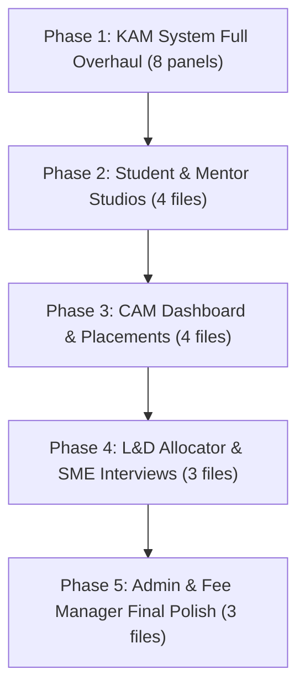

# System-Wide UI Modernization & Shadcn Migration Plan
> **Scope:** Full, role-by-role UI modernization across all 8 roles (Admin, CAM, KAM, Mentor, Student, SME, L&D Allocator, Fee Manager).  
> **Key Targets:** Migrate all 46 raw `<table>` elements to shadcn `<Table>` / `<DataTable>`, implement universal `<Pagination>` on all 28 unpaginated datasets, and replace custom modal backdrops with shadcn `<Dialog>`.

---

## 1. Executive Summary & Inventory

Across all 35+ components in `src/components/`, the following technical debt was audited:

| Issue Type | Count | Impact | Solution |
|---|---|---|---|
| **Raw HTML `<table>` tags** | **46 tables** across 14 components | Broken responsiveness, inconsistent border styles | Standardize on `@/components/ui/table` or `@/components/dashboard/DataTable` |
| **Unpaginated Data Tables** | **28 views** | Stutter and freeze when rendering 500+ rows (e.g. students directory, interview queues) | Implement `@/components/ui/Pagination` (10/25/50/100 rows per page) |
| **Custom Fixed Modals** | **22 modals** | Inconsistent `fixed inset-0 bg-black/50 z-50` overlays | Migrate to `@/components/ui/dialog` or `@/components/ui/sheet` |
| **Raw Buttons with Spinners** | **150+ buttons** | Manual `disabled` state + `<Loader2>` | Replace with `@/components/ui/button` with `isLoading` prop |
| **Inline Status Spans** | **80+ sites** | Inconsistent color codes (`bg-green-100 text-green-700`) | Standardize with `@/components/ui/badge` or `@/components/dashboard/StatusBadge` |
| **Native `<select>` Dropdowns** | **35+ dropdowns** | Non-searchable browser native dropdowns | Use `@/components/ui/combobox` for searchable options |

---

## 2. Core Reusable UI Stack

We standardize on 4 shared UI components:

1. **`DataTable<T>`** (`@/components/dashboard/DataTable`):
   - Combines shadcn `<Table>` with `<Pagination>`.
   - Built-in multi-field search (`searchKeys`).
   - Column sorting (`sortable: true`).
   - Loading skeletons and empty states.
2. **`Pagination`** (`@/components/ui/Pagination`):
   - Page navigation, page size selector, and item range counters.
3. **`StatusBadge`** (`@/components/dashboard/StatusBadge`):
   - Mapped semantic variants: `success`, `warning`, `destructive`, `secondary`.
4. **`ActionDialog`** (`@/components/dashboard/ActionDialog`):
   - Standardized modal for destructive actions (Delete, Approve, Reject).

---

## 3. Role-by-Role Plan of Action

### 1. Key Account Manager (KAM) — Highest Priority
*Currently has 0 out of 10 tables paginated and 9 raw `<table>` tags.*
- **`StudentDirectory.tsx`** (line 189): Replace raw `<table>` with `<DataTable>` (search by Roll No / Name, campus filter, 25-item pagination).
- **`KAMStudentAcademicRisk.tsx`** (line 169): Replace raw `<table>` with `<DataTable>` with risk level badges.
- **`KAMPracticalSkills.tsx`** (line 146): Replace raw `<table>` with `<DataTable>` with batch/branch filter and pagination.
- **`KAMFacultyGovernance.tsx`** (lines 145 & 226): Convert both tables to `<Table>` + `<Pagination>`; add `<StatusBadge>` for punch anomalies.
- **`KAMAssessmentsOversight.tsx`** (line 158): Convert raw `<table>` to `<DataTable>` with 15-item pagination.
- **`KAMAcademicDelivery.tsx`** (line 214): Convert raw `<table>` to `<DataTable>` with syllabus progress bars.
- **`KAMAnalytics.tsx`** (line 593): Convert raw `<table>` to `<Table>` + `<Pagination>`.
- **`Student360.tsx` & `Mentor360.tsx`**: Standardize tabs with shadcn `<Tabs>`.

### 2. Mentor & Student Studios
- **`StudentDashboard.tsx`**:
  - Convert Attendance Logs table (line 3001) to `<Table>` + `<Pagination>`.
  - Convert Mock Interviews table (line 3250) to `<DataTable>`.
  - Convert Contests table (line 3288) to `<DataTable>`.
  - Modernize weekly schedule grid (line 2126) with shadcn `<Table>`.
- **`MentorDashboard.tsx`**:
  - Add `<Pagination>` to student tasks/marks tables (lines 6564, 6673).
  - Convert Study Materials table (line 8852) to `<DataTable>` with search by unit.
  - Modernize timetable schedule grids (lines 5645, 6077, 12121) with `<Table>`.
- **`MentorExamMarksStudio.tsx`**:
  - Add `<Pagination>` (25 students per page) to marks entry table (line 976).
- **`MentorProfileModal.tsx`**:
  - Convert 4 slot and handover tables (lines 515, 722, 766, 814) to `<Table>` + `<Pagination>`. Wrap modal in shadcn `<Dialog>`.
- **`SkillTrackerPanel.tsx`**:
  - Migrate raw `<table>` (line 450) to shadcn `<Table>`.

### 3. Campus Manager (CAM)
- **`CAMDashboard.tsx`**:
  - Add `<DataTable>` with pagination to the 2,000-student directory.
  - Add `<Pagination>` to campus mentors table and day orders table.
  - Migrate top 5 custom modals to shadcn `<Dialog>` / `<Sheet>`.
- **`CMApprovalsHub.tsx`**:
  - Convert pending approval table (line 175) to `<DataTable>` with `<ActionDialog>`.
  - Convert placement eligibility table (line 487) to `<DataTable>`.
- **`ExamScheduleManager.tsx`**:
  - Convert exam schedule tables (lines 1155 & 1347) to `<Table>` with `<Pagination>`.

### 4. L&D Allocator & SME
- **`InterviewModule.tsx`**:
  - Convert candidate directory (lines 889, 4589, 4700) to `<DataTable>` with status filters and 25-item pagination.
- **`LndAllocationDashboard.tsx`**:
  - Add `<Pagination>` to master timetable (line 2749), SME availability (line 3124), allocated demos (line 3553), and requests queue (line 4066).
- **`SMEDashboard.tsx`**:
  - Migrate evaluation matrix (line 1183) to shadcn `<Table>`.
- **`DemoEvalCriteriaPanel.tsx`**:
  - Adopt shadcn `<Card>`, `<Input>`, and `<Button isLoading={...}>`.

### 5. Admin & Fee Manager
- **`AdminDashboard.tsx`**:
  - Complete remaining table migrations (Users, Mentors, Subjects, Monitoring).
  - Adopt `<ActionDialog>` for announcement and user deletion.
- **`CampusAuditManager.tsx`**:
  - Add `<DataTable>` to observation logs and campus audits.
- **`FeeManagerDashboard.tsx`**:
  - Migrate custom modal wrappers to shadcn `<Dialog>`.

---

## 4. Phased Execution Roadmap

---

## 5. Verification Protocol

After each phase:
1. `npx tsc --noEmit` — 0 errors.
2. `npx vitest run` — all 22 test files / 194 tests pass.
3. Smoke test table pagination, search filtering, and modal animations in browser.
