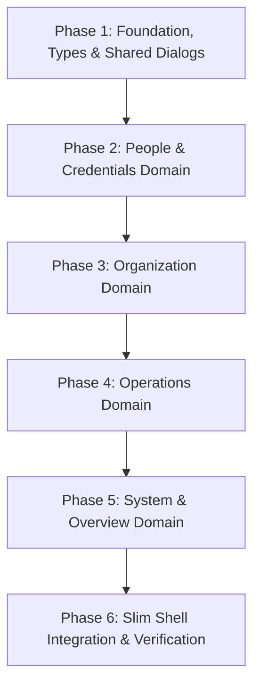

# Admin Panel Architecture & Modernization Plan

> **Target Component:** `src/components/AdminDashboard.tsx` & associated admin routes/modals  
> **Current Footprint:** 10,595 lines, 100+ `useState` hooks, 19 inline tabs, 10+ embedded modals  
> **Objective:** Decompose into modular, lazy-loaded components, modernize UI with shadcn/ui primitives, eliminate mock/static data, isolate data fetching with React Query, and ensure zero regressions across all admin operations.

---

## 1. Executive Summary & Current State Audit

Following an in-depth audit of `src/components/AdminDashboard.tsx`, `src/app/admin/[tab]/page.tsx`, `src/components/admin/AdminSidebar.tsx`, and project issue registries (`ROLE_UI_AUDIT.md`, `SHADCN_MIGRATION_PLAN.md`, `ISSUES_MOCK_DATA.md`), the current state and technical debt are summarized below:

```
+----------------------------------------------------------------------------------------------------+
|                               CURRENT ADMIN PANEL ARCHITECTURE (10,595 Lines)                      |
|                                                                                                    |
|  [AdminDashboard.tsx]                                                                              |
|  ├── Global State & Hooks (100+ useStates, AppContext 30-table mega-payload, queries)              |
|  ├── 19 Inline Tabs:                                                                               |
|  │   Overview · Campuses · KAMs · CAMs · Mentors · Courses · Subjects · Schedules · Monitoring     |
|  │   Hierarchy · Feedback · Logs · Announcements · Holidays · Users · SMEs · Sessions · Settings    |
|  └── 10+ Embedded Dialogs:                                                                         |
|      Campus Wizard · KAM Modal · CAM Modal · Mentor Modal · Faculty Import Modal · User Modal      |
|      Signup Approval · Attendance Clear · Course Modal · Announcement Modal · Test Email           |
+----------------------------------------------------------------------------------------------------+
```

### Critical Findings & Pain Points

1. **Extreme Monolithic Size (10,595 Lines):**
   - Editing any single tab risks breaking unrelated admin functions.
   - Slow Hot Module Replacement (HMR) and sluggish IDE code completion.
   - No code-splitting: the entire admin codebase loads even if the admin only opens "Announcements" or "Campuses".

2. **Data-Layer Inefficiencies & Over-Fetching:**
   - Over-relies on `useApp()` which pulls ~30 tables on startup.
   - Some tabs have dedicated queries with `enabled: activeTab === "..."`, but many still trigger heavy full-table re-renders.

3. **UI System Inconsistency:**
   - Mix of raw HTML elements (`<table>`, `<input>`, `<select>`, `<button>`) with custom utility styles alongside modern shadcn primitives (`@/components/ui/*`).
   - Unpaginated lists in several sub-views causing DOM lag on large datasets.

4. **Static / Mock Data Discrepancies:**
   - **`MD-H05`**: Admin Overview KAM tab contains a static SVG line chart for "Scheduled Hours Trend" instead of real slots data.
   - **`MD-M01`**: Fallback brand name `"FP City Campus"` rendered when a slot has no resolved campus name.
   - **`MD-H12`**: Shift parameters (08:30, 50min periods, etc.) duplicated instead of using `src/lib/shiftDefaults.ts`.
   - **`MD-M04` / `MD-M13`**: Hardcoded sample values in import templates.

5. **Operational Reliability:**
   - Attendance deletion and clear operations require strict parameter alignment and audit logging.
   - Role switching and credential generation require synchronized session states.

---

## 2. Target Architecture (Modular Decomposition)

The updated architecture mirrors the successful modularization of the KAM dashboard (`src/components/kam/*`):

```
src/components/admin/
├── AdminSidebar.tsx                (Already created — rail & drawer support)
├── OversightHub.tsx                (Already extracted — approvals & oversight)
├── AdminDashboardShell.tsx         (Slim coordinator ~250 lines)
│
├── overview/
│   ├── AdminOverviewTab.tsx        (KPI cards, activity feeds, real trend charts)
│   └── ScheduledHoursChart.tsx     (Dynamic SVG/Canvas trend from slots)
│
├── organization/
│   ├── CampusesTab.tsx             (Campus directory, filters, status)
│   ├── CoursesTab.tsx              (Degree & batch configuration)
│   ├── SubjectsTab.tsx             (Subject directory & subject groups)
│   └── HierarchyTab.tsx            (Visual organizational tree)
│
├── people/
│   ├── KamsTab.tsx                 (Key Account Managers directory & allocations)
│   ├── CamsTab.tsx                 (Campus Managers directory & campus link)
│   ├── MentorsTab.tsx              (Faculty list, program tags, status)
│   ├── SmesTab.tsx                 (Subject Matter Experts)
│   └── UsersTab.tsx                (User credentials, role assignments, signups)
│
├── operations/
│   ├── SchedulesTab.tsx            (Master schedule view & slot explorer)
│   ├── MonitoringTab.tsx           (Attendance health & punch monitoring)
│   ├── HolidaysTab.tsx             (Holiday calendar & college scopes)
│   └── AnnouncementsTab.tsx        (Targeted announcements manager)
│
├── system/
│   ├── SettingsTab.tsx             (Email toggle, punch lock, system configs)
│   ├── SessionsTab.tsx             (Active user sessions & termination)
│   ├── FeedbackTab.tsx             (User ticket & feedback triage)
│   └── LogsTab.tsx                 (Audit trail logs & security events)
│
└── dialogs/
    ├── CampusWizardDialog.tsx      (Multi-step campus & shift setup)
    ├── UserCredentialDialog.tsx    (User creation, password reset)
    ├── SignupApprovalDialog.tsx    (Student/Mentor pending approval & mapping)
    ├── FacultyImportDialog.tsx     (Excel/CSV faculty parser & preview)
    ├── ClearAttendanceDialog.tsx   (Attendance purge with preview count & confirmation)
    ├── HolidayDialog.tsx           (Holiday creation & scope modal)
    └── AnnouncementDialog.tsx      (Announcement authoring modal)
```

---

## 3. Detailed Component & Domain Breakdown

### 3.1 Organization Domain (`src/components/admin/organization/`)
- **`CampusesTab.tsx`**:
  - Migrate list to shadcn `<Table>` or `<DataTable>` with search by name/code/city.
  - Quick action pills: Drill-down to CAM view (`OversightHub`), Edit, Shifts, Deactivate.
  - Multi-step `<CampusWizardDialog>` using standard `DEFAULT_SHIFT_CONFIGS` from `src/lib/shiftDefaults.ts`.
- **`CoursesTab.tsx` & `SubjectsTab.tsx`**:
  - Filterable by department, year, semester.
  - Batch creation of courses and curriculum mapping with validation.
- **`HierarchyTab.tsx`**:
  - Visual hierarchy connecting Admins -> KAMs -> Campuses (CAMs) -> Mentors -> Students.

### 3.2 People Domain (`src/components/admin/people/`)
- **`UsersTab.tsx`**:
  - Tabbed split between Active Credentials and Pending Signup Requests.
  - Integration of `<Pagination>` (25/50/100 users per page).
  - Quick password reset generator with copy-to-clipboard and audit logging.
  - `<SignupApprovalDialog>` with student/mentor profile auto-linking.
- **`MentorsTab.tsx`**:
  - Directory with status badges (`Active`, `On Leave`, `Unassigned`).
  - `<FacultyImportDialog>` with file upload validation, column matching, and preview table.

### 3.3 Operations Domain (`src/components/admin/operations/`)
- **`MonitoringTab.tsx`**:
  - Live attendance health across campuses.
  - Dedicated `<ClearAttendanceDialog>`: ensures preview count uses identical canonical search params (`startDate`, `endDate`, `collegeId`, `department`, `classGroup`) as the DELETE call.
  - Immediate `refreshAttendance()` trigger after execution.
- **`SchedulesTab.tsx`**:
  - Interactive grid/table of scheduled classes.
  - Replaces hardcoded fallback `"FP City Campus"` with clear unassigned indicator.
- **`HolidaysTab.tsx` & `AnnouncementsTab.tsx`**:
  - Modernized with `<ActionDialog>` for deletion and `<StatusBadge>` for target roles.

### 3.4 System & Analytics Domain (`src/components/admin/system/` & `overview/`)
- **`AdminOverviewTab.tsx`**:
  - Top metric cards (Total Campuses, Active Mentors, Students Enrolled, Today's Scheduled Slots).
  - Dynamic **Scheduled Hours Trend** chart computed from real slot records instead of static mock SVG.
  - System health pulse: Resend email status, Database connectivity, Active session count.
- **`SettingsTab.tsx`**:
  - Toggles for System Mailing, Attendance Punch Lock, and Maintenance Mode.
  - Resend SMTP / API configuration test utility.
- **`FeedbackTab.tsx` & `LogsTab.tsx`**:
  - Searchable audit log with timestamp, action type, user, and IP.
  - Issue ticket resolution flow with resolution notes and status tracking.

---

## 4. Phased Implementation Roadmap



| Phase | Tasks & Modules | Deliverables | Risk / Complexity |
|---|---|---|---|
| **Phase 1: Foundation & Dialogs** | Extract common admin types, form interfaces, and shared dialogs (`CampusWizardDialog`, `UserCredentialDialog`, `ClearAttendanceDialog`, `FacultyImportDialog`). | Modular dialog components in `src/components/admin/dialogs/`. | Low / Safe |
| **Phase 2: People Domain** | Build `UsersTab.tsx`, `KamsTab.tsx`, `CamsTab.tsx`, `MentorsTab.tsx`, `SmesTab.tsx` using shadcn `<Table>` and `<Pagination>`. | 5 isolated tab components under `src/components/admin/people/`. | Medium |
| **Phase 3: Organization Domain** | Extract `CampusesTab.tsx`, `CoursesTab.tsx`, `SubjectsTab.tsx`, `HierarchyTab.tsx`. Link shift defaults. | 4 isolated tab components under `src/components/admin/organization/`. | Medium |
| **Phase 4: Operations Domain** | Extract `SchedulesTab.tsx`, `MonitoringTab.tsx`, `HolidaysTab.tsx`, `AnnouncementsTab.tsx`. Fix attendance clear preview sync. | 4 isolated tab components under `src/components/admin/operations/`. | Medium |
| **Phase 5: System & Overview** | Build `AdminOverviewTab.tsx` (dynamic trend chart), `SettingsTab.tsx`, `SessionsTab.tsx`, `FeedbackTab.tsx`, `LogsTab.tsx`. | 5 isolated tab components under `src/components/admin/system/` & `overview/`. | Low |
| **Phase 6: Shell Integration & Verification** | Refactor `AdminDashboard.tsx` into a lightweight dynamic-importing shell (`~250 lines`). Verify routing, typecheck, and test suite. | `AdminDashboard.tsx` slimmed by ~97%. Zero regressions. | Medium |

---

## 5. Verification Protocol & Quality Gates

Each phase must satisfy the following verification steps before proceeding:

1. **Type Safety & Build:**
   ```bash
   npx tsc --noEmit
   ```
   Must pass with 0 errors.

2. **Automated Test Suite:**
   ```bash
   npx vitest run
   ```
   All 190+ existing unit and integration tests must pass.

3. **Routing & Navigation Smoke Test:**
   - Deep-linking to `/admin/overview`, `/admin/campuses`, `/admin/users`, `/admin/monitoring`, etc.
   - Backward compatibility for legacy aliases (e.g. `schedule` -> `schedules`, `attendance` -> `monitoring`).
   - Browser back/forward navigation (`popstate`) consistency.

4. **Data Mutation & Security Checks:**
   - Create, edit, and delete actions in Campuses, Users, and Holidays work with correct server authorization.
   - Attendance clear preview count exactly matches deleted record count.
   - Audit log captures destructive actions.
